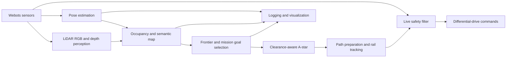

# AUR — Autonomous Robots

AUR is an independently engineered Python controller for autonomous mapping and navigation with a simulated Husarion ROSbot in Webots. It connects robot sensing, occupancy and semantic mapping, frontier exploration, clearance-aware planning, path tracking, and guarded motion control in one experimental autonomy pipeline.

> **Status: Under Refinement**
> The current controller is published as engineering work in progress. It is not presented as a finished or generally reliable autonomous-navigation system.

## Implemented capabilities

The source currently includes:

- ROSbot sensor discovery and differential-drive actuation
- wheel-encoder odometry with IMU heading and compass fallback
- sparse LiDAR log-odds occupancy mapping
- guarded scan-matching and map-update diagnostics
- RGB/depth processing for colored landmarks, green hazards, and structural obstacles
- frontier detection, clustering, selection, and unreachable-goal handling
- clearance-aware grid A* planning and path validation
- rail-style path tracking, command ramping, local clearance checks, and recovery behaviors
- a blue-then-yellow semantic mission state machine
- structured run metadata, event, path, sample, and summary logging

Implemented does not mean fully validated. Several experimental planners and control filters exist in the source but are disabled in the selected configuration. See [Algorithms](docs/ALGORITHMS.md) for the active/disabled distinction.

## Repository navigation

```text
.
├── README.md
├── .gitignore
├── Maze1/
│   └── controllers/
│       └── my_controller/
│           └── my_controller.py
└── docs/
    ├── ARCHITECTURE.md
    ├── ALGORITHMS.md
    └── DEVELOPMENT_STATUS.md
```

- [Architecture and code navigation](docs/ARCHITECTURE.md)
- [Algorithms and design decisions](docs/ALGORITHMS.md)
- [Current revision, evidence, and known issues](docs/DEVELOPMENT_STATUS.md)

## Publication scope

This repository contains the independently developed controller and its technical documentation. The separate academic team submission, private development history, course materials, run logs, generated maps, and evaluation worlds are not distributed here.

The world used during development is not included because permission to redistribute the course-provided layout has not been established. This is therefore a **code-only publication**, not a self-contained reproducibility package.

## Technology

The controller was developed against:

- Webots R2025a world/controller APIs
- Python 3.10
- NumPy
- OpenCV
- the Webots Husarion ROSbot model with LiDAR, RGB-D camera, IMU, compass, wheel encoders, and four wheel motors

The exact audited environment and selected source identity are recorded in [Development Status](docs/DEVELOPMENT_STATUS.md).

## Installation

Install Webots R2025a and ensure NumPy and OpenCV are available to the Python interpreter used by Webots:

```bash
python3 -m pip install numpy opencv-python
```

Webots supplies the `controller` Python module at runtime; it is not installed from PyPI.

Compatibility with newer Webots, NumPy, and OpenCV releases has not yet been evaluated systematically.

## Running with an authorized world

No runnable `.wbt` world is distributed in this snapshot. To execute the controller, use a world that you created or are authorized to use and place it in the same Webots project structure:

```text
Maze1/
├── controllers/my_controller/my_controller.py
└── worlds/your_authorized_world.wbt
```

The robot node must select `controller "my_controller"` and expose devices compatible with the controller's ROSbot device discovery. Open the authorized world with Webots, for example:

```bash
webots Maze1/worlds/your_authorized_world.wbt
```

The development configuration enables autonomous startup and mission logic. Keyboard controls are also available:

- `W`, `A`, `S`, `D`: manual drive
- `E`: toggle autonomous exploration
- `R`: request replanning
- `M`: save the current map
- `Space`: stop
- `Q`: exit the controller

Runtime outputs such as `run_logs/`, `saved_map.pkl`, and `sensor_debug_log.csv` are generated in the controller working directory and are ignored by Git.

## Architecture



Most behavior remains in a single `MappingController` class. The [architecture guide](docs/ARCHITECTURE.md) maps its responsibilities without implying that the controller has been modularized.

## Testing and evidence

There is no automated test suite yet. The selected source passes Python syntax compilation, and development runs provide revision-specific system evidence.

The latest audited run demonstrated initialization, mapping, motion, planning, replanning, and logging, but did not complete its semantic mission. Older revisions recorded successful target completion in specific runs; those historical results are not treated as proof that the current revision is reliable. Exact revision and evidence details are maintained in [Development Status](docs/DEVELOPMENT_STATUS.md).

Because the evaluated maze cannot currently be redistributed, third parties cannot reproduce those exact runs from this repository alone.

## Known limitations

- The selected controller has not demonstrated reliable mission completion.
- The published snapshot does not include an evaluation world.
- Localization and sensing assumptions are specific to the simulated ROSbot configuration.
- The monolithic controller carries substantial shared state and tuning complexity.
- Automated unit, integration, and regression testing is not yet available.
- Contact/collision reporting is heuristic rather than ground-truth collision measurement.
- Real-robot operation has not been established.

## Authorship and attribution

This controller was independently engineered by the repository owner in the context of an academic Autonomous Robots project. A different implementation was submitted by teammates; their work is not included in this repository.

The controller targets Cyberbotics Webots and the simulated Husarion ROSbot. The Webots software and referenced robot assets are subject to their respective upstream terms and are not distributed in this code-only repository. No license has been granted for this controller; its public availability does not by itself authorize reuse, modification, or redistribution beyond applicable legal rights.
