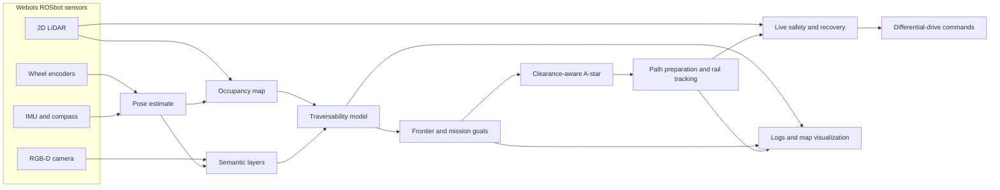
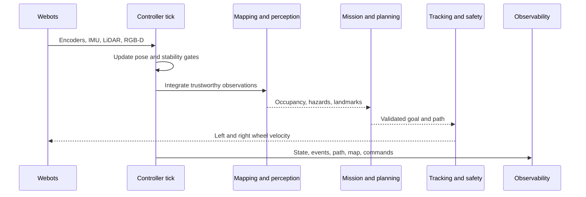

<div align="center">

# AUR — Autonomous Robots

**An experimental autonomy controller for a simulated Husarion ROSbot in Webots**

LiDAR occupancy mapping · RGB-D semantic perception · frontier exploration · clearance-aware planning · guarded motion control

**Status: Under Refinement** · Code-only publication · Webots R2025a

</div>

> [!IMPORTANT]
> AUR is published as engineering work in progress. The current controller can initialize, map, plan, move, replan, and log its behavior, but it has not demonstrated reliable mission completion. Historical successful runs belong to older revisions and are not validation of the published controller.

## System overview

AUR connects perception, mapping, exploration, planning, and control in one Python controller. The simulated robot builds a sparse occupancy map from LiDAR, adds semantic evidence from RGB-D observations, selects exploration or mission goals, plans footprint-aware paths, and passes motion commands through live safety and recovery logic.



### What is implemented

| Subsystem | Current implementation |
|---|---|
| Localization | Wheel-encoder odometry with IMU heading, compass fallback, and guarded scan-matching diagnostics |
| Mapping | Sparse 0.05 m log-odds LiDAR grid plus depth-derived structural, hazard, and landmark layers |
| Exploration | Frontier detection, clustering, contextual scoring, commitment, and unreachable-goal handling |
| Planning | Eight-connected clearance-aware A* with path audits, footprint constraints, and guarded relaxation |
| Tracking | Rail-style path following, command ramping, live clearance checks, and bounded recovery actions |
| Mission logic | Blue-then-yellow target search, access exploration, terminal routing, approach, and verification states |
| Observability | Revision metadata, event traces, path records, periodic samples, summaries, and rendered map overlays |

Implemented source is not the same as validated performance. Experimental ESDF optimization, command-level MPC-lite, and CBF filtering exist in the controller but are disabled in the published configuration. See [Algorithms and design decisions](docs/ALGORITHMS.md) for the active/disabled boundary.

## Visual evidence

The original academic Webots world is not distributed because permission to republish its layout has not been established. For the same reason, screenshots and generated maps that reveal that layout are intentionally excluded from this public snapshot.

When publication-safe visuals become available, this section will present them beside the subsystem they document and identify the controller revision, world, and run where that provenance is known. A plotted path or map view will be described as an observed artifact—not as proof of mission success.

## How the autonomy loop runs



The selected implementation is intentionally preserved as a single controller file for this publication snapshot. Its internal subsystem boundaries and code ranges are documented in [Architecture and code navigation](docs/ARCHITECTURE.md).

## Repository guide

```text
.
├── README.md
├── Maze1/
│   └── controllers/
│       └── my_controller/
│           └── my_controller.py
└── docs/
    ├── ARCHITECTURE.md
    ├── ALGORITHMS.md
    └── DEVELOPMENT_STATUS.md
```

| Document | Purpose |
|---|---|
| [Architecture](docs/ARCHITECTURE.md) | Runtime data flow, subsystem responsibilities, shared state, and code navigation |
| [Algorithms](docs/ALGORITHMS.md) | Active algorithms, assumptions, disabled experiments, and design trade-offs |
| [Development status](docs/DEVELOPMENT_STATUS.md) | Selected revision, environment, available evidence, known issues, and publication boundary |

## Requirements

The controller was developed with:

- Webots R2025a and its Python controller API
- Python 3.10
- NumPy 1.21.5
- OpenCV 4.5.4
- a Webots Husarion ROSbot configuration exposing LiDAR, RGB-D, IMU, compass, wheel encoders, and four wheel motors

Install NumPy and OpenCV into the Python environment used by Webots:

```bash
python3 -m pip install numpy opencv-python
```

Webots provides the `controller` module at runtime; it is not installed from PyPI. Compatibility with other Webots, NumPy, or OpenCV versions has not been systematically evaluated.

## Running the controller

This repository is a **code-only publication**. It does not contain the private academic evaluation world, so it is not a self-contained simulation package.

To run the controller, supply a Webots world that you created or are authorized to use:

```text
Maze1/
├── controllers/my_controller/my_controller.py
└── worlds/your_authorized_world.wbt
```

The robot node must select `controller "my_controller"` and provide a compatible ROSbot device configuration. Then open the world with Webots:

```bash
webots Maze1/worlds/your_authorized_world.wbt
```

The development configuration starts autonomous mission logic automatically. Manual controls remain available:

| Key | Action |
|---|---|
| `W` `A` `S` `D` | Manual drive |
| `E` | Toggle autonomous exploration |
| `R` | Request replanning |
| `M` | Save the current map |
| `Space` | Stop |
| `Q` | Exit the controller |

Runtime logs, saved maps, and caches are generated beside the controller and ignored by Git.

## Current engineering status

The current source passes Python syntax compilation and has recorded runs showing initialization, mapping, movement, planning, replanning, and logging. The latest recorded run did **not** complete the semantic mission. There is no automated test suite or public evaluation world yet, so the repository does not claim reproducible end-to-end performance.

Primary limitations:

- mission completion is not reliable in the selected revision;
- the original evaluation world cannot currently be redistributed;
- localization and perception assumptions are simulation-specific;
- the 31,139-line controller has substantial shared state and tuning complexity;
- contact and collision indicators are heuristic, not simulator ground truth;
- real ROS/ROS 2 integration and real-robot operation have not been established.

Revision-specific evidence and the concrete refinement backlog are maintained in [Development status](docs/DEVELOPMENT_STATUS.md).

## Scope, authorship, and attribution

This repository contains the owner's independent controller implementation, developed in an academic project context. A separate team submission has its own authorship and development history; it is not included, required, or represented here.

Despite the repository name, AUR controls the simulated ROSbot directly through the Webots Python API. It is **not** currently a ROS or ROS 2 package.

The controller targets Cyberbotics Webots and the simulated Husarion ROSbot. The Webots software and referenced robot assets are subject to their respective upstream terms and are not distributed in this code-only repository. No license has been granted for this controller; its public availability does not by itself authorize reuse, modification, or redistribution beyond applicable legal rights.
