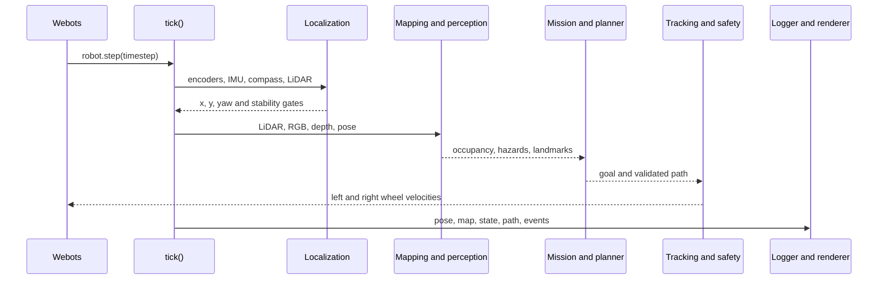

# Architecture and Code Navigation

This document maps the controller at `Maze1/controllers/my_controller/my_controller.py`. Line numbers refer to the published `Task22N_Fix12_global_frontier_execution_handoff` source snapshot with SHA-256 `79bcf4f34876383a0145a4d4975eb582f38a296c4f425af764c9da24b56e8aa7` and may become outdated after future code changes.

## Structural overview

The file contains three top-level implementation classes:

| Lines | Symbol | Responsibility |
|---:|---|---|
| 1728–1736 | `EMA` | Small exponential moving-average helper. |
| 1739–1803 | `OccupancyGrid` | Sparse log-odds grid, coordinate conversion, Bresenham ray traversal, and scan integration. |
| 1805–1885 | `CorrelativeScanMatcher` | LiDAR point extraction and local correlative scan scoring. |
| 1887–31134 | `MappingController` | Device I/O, state, mapping, semantic perception, mission logic, planning, control, recovery, rendering, and logging. |

`MappingController` has 626 methods in this snapshot. Its shared state and size are maintainability concerns; the current source has not been modularized.

## Runtime data flow

The main loop is `run()` at line 31132. Each Webots step calls `tick()` at line 30906. `tick()` processes input and localization, reads LiDAR, performs scan matching, updates map layers, invokes `_auto_step()`, logs the state, and renders the map.

## Code map

The following ranges are logical navigation aids, not independent modules.

| Approximate lines | Subsystem | Representative entry points |
|---:|---|---|
| 1–1718 | Configuration | Geometry, sensor, mapping, mission, planning, control, safety, and logging constants; `CONTROLLER_VERSION` at 1701. |
| 1888–5199 | Initialization and observability | `__init__`, `_init_run_logger`, `_run_log_sample`, `_write_run_summary`, `_init_camera`, `_init_lidar`, `_init_depth`, `_init_wheels`. |
| 5200–6209 | Commands and exploration bootstrap | `_set_drive_command`, `_handle_keyboard`, `_start_initial_panorama`, `_initial_panorama_step`, `_auto_bootstrap_drive`. |
| 6211–6789 | Heading and localization | `_read_imu_yaw_active`, `_read_compass_xy_yaw_active`, `_update_heading`, `_update_pose`, `_detect_odom_slip_contact`. |
| 6794–10318 | Depth and semantic perception | Slab fitting, green-layer stamping, pillar observation/locking, RGB-D/LiDAR association, chassis-layer maintenance, depth override logic. |
| 10318–10938 | Map-update gating | Scan-consensus diagnostics, scan-match application gates, pose-stability checks, and `_integrate_lidar_scan`. |
| 10939–12099 | Traversability and global planning primitives | Clearance fields, planner obstacle construction, candidate audits, frontier extraction, and `_astar_cells`. |
| 12100–20600 | Mission management | Blue/yellow state transitions, visual verification, standoff selection, target-access exploration, terminal routes, side-orbit and final-approach logic, `_mission_step`. |
| 20601–23844 | Exploration and planner recovery | Failed-goal blacklists, collision penalties, rescue paths, frontier scoring/commitment, suspect-pillar inspection, loop escape, `_plan_frontier_path`. |
| 23845–26103 | Path validation and shaping | Replan checks, dynamic hazards, path-progress monitoring, light simplification, ESDF candidate code, path-MPC reference generation, `_prepare_auto_follow_path`. |
| 26104–29519 | Local control and safety | Local clearance commands, waypoint/pure-pursuit/rail tracking, contact estimation, live safety filtering, deadlock watches, recovery sequences, optional MPC-lite and CBF filters. |
| 29520–30451 | Autonomous orchestration | `_auto_step` coordinates panorama, mission, exploration, planning, following, replanning, and recovery. |
| 30452–30905 | Persistence and visualization | `save_map`, `_render_map_only`, semantic overlays, and `_print_banner`. |
| 30906–31134 | Webots loop | `tick` and `run`. |

## Important state and interfaces

There are no formal module interfaces; subsystems communicate through `MappingController` fields.

- Pose: `x`, `y`, `yaw`, heading-source and odometry state.
- Maps: `grid` plus LiDAR, chassis, green-hazard, and blue/yellow landmark layers.
- Navigation: `auto_goal`, raw/smoothed/optimized paths, follow points, and path indices.
- Mission: `_mission_state`, target color, reached flags, target locks, and verification state.
- Safety and recovery: latest LiDAR sectors, live-clearance state, contact/deadlock watches, blacklists, and recovery sequence state.
- Evidence: run-log writers, counters, transition events, periodic samples, path records, and rendered frames.

This shared-state design keeps execution local and inspectable, but makes unit isolation and invariant enforcement difficult.

## Webots integration boundary

During development, the controller was resolved through Webots' conventional `controllers/my_controller/my_controller.py` layout and a robot node selecting `controller "my_controller"`. The code-only public snapshot preserves that controller path but does not distribute the academic `.wbt` world because permission for the course-provided layout remains unresolved.

An authorized replacement world must provide a compatible Husarion ROSbot device configuration. Device initialization accepts several aliases, but the verified development configuration used LiDAR, RGB-D, IMU, compass, wheel encoders, and four wheel motors. World compatibility is therefore an integration requirement, not guaranteed by the controller file alone.

## Future modularization opportunities

The following are potential future engineering tasks, not features implemented in the current source:

1. Extract immutable configuration and robot geometry first, while retaining identical values.
2. Isolate run logging and rendering because they have clear side-effect boundaries.
3. Introduce typed snapshots for pose, sensor observations, map layers, and navigation status.
4. Separate pure grid/path functions and add characterization tests before moving stateful mission logic.
5. Split mission, exploration, tracking, and safety only after existing event traces can detect behavioral drift.

A broad rewrite would be risky because many methods rely on timing and shared state. Characterization tests should precede structural changes.
